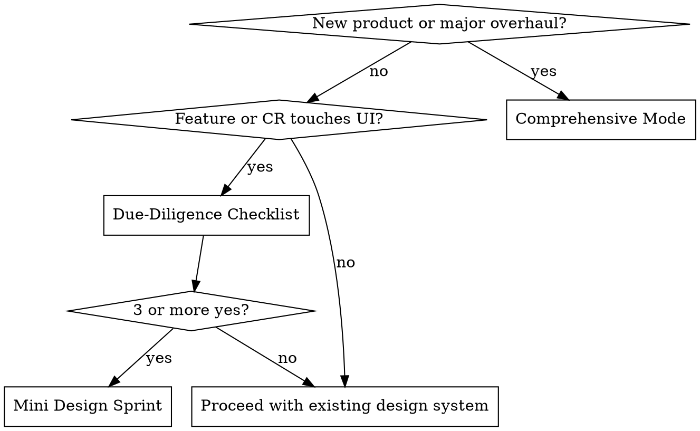

# UX Design Workflow Integration — Implementation Plan

> **For Claude:** REQUIRED SUB-SKILL: Use superpowers:executing-plans to implement this plan task-by-task.

**Goal:** Integrate a design-before-coding workflow into Claude Code, GSD, and OpenSpec as a foundation template competency — a personal skill file, a foundation spec, a CLAUDE.md rule, and a CLI pointer.

**Architecture:** A personal skill (`~/.claude/skills/ux-design-workflow/SKILL.md`) provides interactive execution. A foundation spec (`openspec/specs/foundation/ux-design.md`) carries the principles to new projects. CLAUDE.md Rule 7 tells Claude when to invoke the skill. The CLI next steps pointer surfaces it to new project creators.

**Tech Stack:** Markdown skill files, OpenSpec foundation spec (Markdown), TypeScript (`packages/create-foundation-app/src/index.ts` for CLI pointer), CLAUDE.md.

**Critical constraint:** The skill file MUST be written following the writing-skills TDD discipline — baseline test WITHOUT the skill first, THEN write the skill, THEN verify. The Iron Law: no skill without a failing test first. See superpowers:writing-skills.

---

### Task 1: Create the `ux-design-workflow` Skill (TDD)

**Files:**

- Create: `~/.claude/skills/ux-design-workflow/SKILL.md`

---

**Step 1: Create the baseline test scenario (pressure scenario)**

Before writing the skill, document what Claude does WITHOUT it. Create the following test prompt:

```
BASELINE TEST PROMPT (save this for reference):

"We're starting development on a new B2B SaaS application — a project management tool for design teams. I want to begin working on the UI. Where do we start?"
```

---

**Step 2: Run the baseline test WITHOUT the skill**

Dispatch a subagent (fresh context, no skill loaded) with the baseline prompt above. Observe and document:

- Does it ask about intensity/criticality before anything else?
- Does it surface a Phase 0 assessment?
- Does it ask tooling checkpoint questions at phase boundaries?
- Does it distinguish comprehensive vs. due-diligence modes?

**Expected baseline behavior (what failure looks like):**

- Jumps straight to discussing colors, typography, or component choices
- No structured phase framework
- No intensity classification
- No tooling checkpoint questions
- No distinction between new product and feature/CR contexts

Document the exact rationalizations the subagent uses (e.g., "Let me help you choose a color palette" or "We should start with your brand colors").

---

**Step 3: Write the skill file**

Create `~/.claude/skills/ux-design-workflow/SKILL.md` with this exact content:

````markdown
---
name: ux-design-workflow
description: Use when starting a project with user-facing UI before planning UI features, or when a feature or change request involves visual changes. Does not apply to backend-only, CLI, or API-only work.
---

# UX Design Workflow

## Overview

Design decisions made before coding compound positively — established tokens, personality, and references make every future UI implementation consistent. Made after coding starts, design changes require expensive rework.

**Core principle:** Establish design DNA first. Code second.

**Relationship to `frontend-design` skill:** This workflow establishes WHAT to build and HOW it should look. `frontend-design:frontend-design` implements individual components using those decisions. Run this workflow first, then use `frontend-design`.

## Mode Selection


````

## Comprehensive Mode — Phase 0: UI/UX Role & Criticality Assessment

**Run this before any other phase. Always.**

Ask these three questions, then classify:

1. **Product type:** B2C consumer / B2B SaaS / developer tool / internal tool?
2. **User design-awareness:** Design-savvy consumers / enterprise users / developers?
3. **Competitive differentiation:** Is design a primary moat, or secondary to functionality?

**Intensity → phases to run:**

| Intensity | Phases | When                                          |
| --------- | ------ | --------------------------------------------- |
| High      | 0 → 7  | Consumer apps, design-led B2B SaaS            |
| Medium    | 0 → 5  | Standard B2B SaaS, marketplaces               |
| Low       | 0 → 3  | Developer tools, API products, internal admin |

Present classification and confirm before proceeding.

## Comprehensive Mode — Phases 1–7

### Phase 1: Personality Workshop

Ask: "Describe your product's personality in 5–7 adjectives. How should users feel using it? What products have a similar vibe?"

Derive:

- **Tone:** How the product communicates (e.g., "Direct and confident, never formal")
- **Anti-patterns:** What to explicitly avoid (e.g., "Never playful, never enterprise-grey")

Output a personality doc (3–5 bullets). Confirm before Phase 2.

---

### Phase 2: Reference Mining

**Tooling checkpoint:**

```
Phase 2 — Reference Mining
Default: Mobbin (mobbin.com) + Figma plugin for bulk import.
→ Use Mobbin, or different approach? (Alternatives: Dribbble, Pinterest, manual screenshots)
```

Find 10–15 real app screenshots embodying the Phase 1 personality. For each: "What specifically works here?"

Output: annotated reference list (app + what works + why it fits personality).

---

### Phase 3: Token Decisions

**Tooling checkpoint:**

```
Phase 3 — Token Decisions
Default: tweakcn.com — visual shadcn/ui token editor, exports CSS variables directly.
→ Use tweakcn.com, or different approach? (Alternatives: Figma Tokens plugin, manual CSS variables)
```

Guide in this order:

1. Primary color → translate personality adjectives to hue/saturation
2. Accent color → secondary action color
3. Typography → serif vs sans-serif, weight
4. Border radius → sharp (0px) / rounded (8px+) / pill
5. Spacing rhythm → 4px or 8px grid

Output: token decisions documented, CSS variables ready.

---

### Phase 4: IA + Wireframes _(Medium/High intensity)_

**Tooling checkpoint:**

```
Phase 4 — IA + Wireframes
Default: Figma (lo-fi frames, no visual styling).
→ Use Figma, or different approach? (Alternatives: Excalidraw, FigJam, paper sketch)
```

1. List all screens/pages needed
2. Define primary navigation structure
3. Lo-fi wireframes for 3 most critical screens

Output: screen inventory + wireframe artifacts.

---

### Phase 5: Design System Bootstrap _(Medium/High intensity)_

**Tooling checkpoint:**

```
Phase 5 — Design System Bootstrap
Default: Figma design system file + shadcn/ui configured with Phase 3 tokens.
→ Use Figma, or different approach? (Alternatives: Penpot, Storybook-first, no dedicated file)
```

1. Apply Phase 3 tokens to shadcn/ui (`globals.css` or `tailwind.config.ts`)
2. Set up base component library in chosen tool
3. Document component usage rules

Output: configured design system.

---

### Phase 6: High-Fidelity Key Screens _(High intensity only)_

**Tooling checkpoint:**

```
Phase 6 — High-Fidelity Screens
Default: Figma (full visual design using Phase 5 components).
→ Use Figma, or skip based on intensity classification?
```

Design 3–5 critical screens at full fidelity. These are the Phase 7 source of truth.

Output: Figma frames ready for handoff.

---

### Phase 7: Design → Code _(High intensity only)_

**Tooling checkpoint:**

```
Phase 7 — Design to Code
Default: Figma MCP (bidirectional — extracts tokens and component specs directly).
→ Use Figma MCP, or alternative? (Alternative: frontend-design skill + Phase 6 screenshots)
```

**If Figma MCP:** Extract specs via MCP, then invoke `frontend-design:frontend-design` with extracted specs.

**If screenshots:** Export Phase 6 screens, invoke `frontend-design:frontend-design` with screenshot + Phase 1 personality doc.

---

## Due-Diligence Mode

Run before planning any feature or CR with a UI component:

1. Does this feature change any visual surface?
2. Does it introduce new components or interaction patterns?
3. Are existing design tokens sufficient, or does it need new ones?
4. Would a Mobbin reference search surface anything useful?
5. Is a Figma frame needed for this feature?

**3+ yes:** Run mini design sprint (Phases 1–3 scoped to this feature) before planning.
**2 or fewer yes:** Proceed using the existing design system.

## Common Mistakes

| Mistake                                        | Fix                                                                             |
| ---------------------------------------------- | ------------------------------------------------------------------------------- |
| Jumping to colors before Phase 0               | Phase 0 is mandatory. Intensity gates how far you go.                           |
| Making all tooling decisions upfront           | Ask at each phase boundary — earlier choices constrain later ones               |
| Running all 7 phases for a developer tool      | Low intensity = Phases 0–3 only. Stop there.                                    |
| Using frontend-design instead of this workflow | frontend-design implements. This workflow establishes. Run this first.          |
| Skipping due-diligence for small UI changes    | Small changes accumulate into inconsistent UI. Always run the 5-question check. |

```

---

**Step 4: Run the verification test WITH the skill**

Load the skill and dispatch a subagent with the same baseline test prompt. Verify:
- [ ] Subagent runs Phase 0 before anything else
- [ ] Asks all three assessment questions
- [ ] Presents intensity classification and confirms
- [ ] Shows tooling checkpoint at Phase 2 start
- [ ] Shows tooling checkpoint at Phase 3 start
- [ ] Adapts phase list based on intensity

If subagent violates any item above, update the skill to close the loophole, then re-verify.

---

**Step 5: Run a second verification — due-diligence mode**

Dispatch a subagent with:
```

VERIFICATION PROMPT 2:

"We're adding a new 'Team Settings' page to an existing B2B SaaS app. Should we do any design work before planning this?"

````

Verify:
- [ ] Subagent does NOT run comprehensive mode
- [ ] Runs the 5-question due-diligence checklist
- [ ] Scores correctly and makes proceed/sprint recommendation

---

**Step 6: Commit the skill**

```bash
git add ~/.claude/skills/ux-design-workflow/SKILL.md
git commit -m "feat(skills): add ux-design-workflow personal skill"
````

Note: `~/.claude/` is outside the foundation-template repo. This commit is to your personal Claude config, not the template. The skill is immediately available to all projects.

---

### Task 2: Create the Foundation Spec

**Files:**

- Create: `openspec/specs/foundation/ux-design.md`

---

**Step 1: Create the spec file**

Create `openspec/specs/foundation/ux-design.md` with this exact content:

```markdown
# UX Design Workflow Specification

> Baseline specification for the Foundation Template.
> This document is the source of truth. All implementations must conform to these specs.

## Overview

The Foundation Template includes a design-before-coding workflow as a core competency. UI/UX decisions made before implementation compound positively — established tokens, personality, and reference systems make every future component consistent. Design decisions made after coding begins require expensive rework and drift.

**Why this is a foundation competency:** Without a structured design process, AI agents implementing UI default to arbitrary aesthetic choices. Each feature ends up with independently invented colors, spacing, and component styles that are visually inconsistent. A design system established before coding is the single source of truth all agents reference.

**Executable version:** The `ux-design-workflow` personal skill (at `~/.claude/skills/ux-design-workflow/SKILL.md`) provides interactive execution of this workflow. This spec defines the principles and rationale; the skill provides the step-by-step guidance.

**Relationship to `frontend-design` skill:** The `frontend-design:frontend-design` skill implements individual components. This workflow establishes the design system those components live within. Sequence: `ux-design-workflow` → `frontend-design`. Never the reverse.

## Specifications

### Two Modes

#### Comprehensive Mode (New Product or Major Overhaul)

Used when starting a new product or redesigning a significant portion of an existing one. Consists of Phase 0 (mandatory) followed by intensity-gated phases 1–7.

**When:** First milestone with UI features on a new product.

**Trigger:** CLAUDE.md Rule 7 requires invoking `ux-design-workflow` skill before any GSD phase planning for UI.

#### Due-Diligence Mode (Feature or Change Request)

A 5-question checklist that gates whether design work is needed for a specific feature.

**When:** Before planning any feature or CR that touches UI.

**Checklist:**

1. Does this feature change any visual surface?
2. Does it introduce new components or interaction patterns?
3. Are existing design tokens sufficient, or does it need new ones?
4. Would a reference search surface anything useful?
5. Is a design frame needed for this feature?

**Scoring:** 3+ yes → mini design sprint (Phases 1–3 scoped to feature) before planning. 2 or fewer → proceed using existing design system.

**Rationale:** Not every UI feature warrants a design sprint. A settings page toggle doesn't need new tokens. A new onboarding flow might. The checklist prevents both over-investment (full design sprint for a minor change) and under-investment (shipping a major flow with no design work).

### Phase 0: UI/UX Role & Criticality Assessment

**Mandatory before all other phases.** Phase 0 classifies design intensity, which determines which subsequent phases run. Skipping Phase 0 means running phases that may not be warranted (wasted effort) or skipping phases that are critical (inconsistent output).

**Assessment dimensions:**

1. **Product type:** B2C consumer / B2B SaaS / developer tool / internal tool
2. **User design-awareness:** How design-literate is the target user?
3. **Competitive differentiation:** Is design a primary competitive moat or secondary?

**Intensity classification:**

| Intensity | Phases | Rationale                                                                                                  |
| --------- | ------ | ---------------------------------------------------------------------------------------------------------- |
| High      | 0 → 7  | Consumer apps and design-led B2B SaaS compete on design quality. Full investment justified.                |
| Medium    | 0 → 5  | B2B SaaS competes primarily on functionality. Design system bootstrapped but high-fi screens optional.     |
| Low       | 0 → 3  | Developer tools and internal admin compete on capability, not aesthetics. Personality + tokens sufficient. |

**Why this matters:** A developer tool that spends two weeks on Figma high-fidelity screens has misallocated effort. A consumer app that skips Phase 6 ships a product that cannot compete on design with native apps. Intensity classification is the mechanism that prevents both.

### Phase 1: Personality Workshop

**Output:** Personality document (5–7 adjectives, tone statement, anti-patterns list)

**What:** Define the product's emotional identity before any visual decisions. Personality drives all downstream token choices — a "warm, approachable" product has different colors and radius than a "precise, professional" one.

**Why personality before tokens:** Tokens without personality produce arbitrary decisions. "Should the border radius be 4px or 12px?" has no answer without knowing whether the product is sharp/precise or friendly/rounded. Personality makes token decisions obvious rather than arbitrary.

**Rejected alternative:** Jumping directly to color selection without personality context. This produces tokens that reflect the designer's personal taste rather than the product's identity.

### Phase 2: Reference Mining

**Output:** Annotated reference collection (10–15 real app screenshots with "what works" notes)

**Default tool:** Mobbin (mobbin.com) with Figma plugin for bulk import.
**Alternatives:** Dribbble, Pinterest boards, manual screenshots.

**Why real app references:** Figma mockups and design templates represent idealized design. Real shipped products represent production constraints and actual user-tested patterns. References from Mobbin are screenshots of apps that millions of people actually use — they encode what works.

**Why annotate:** References without annotation become mood boards that don't inform decisions. The annotation ("the navigation bar works here because it's always visible without taking screen real estate") translates reference screenshots into principles that Claude can apply.

**Tooling decision:** Made at the start of Phase 2, not upfront. Tool choice depends on what the user already has access to and what their Figma setup looks like.

### Phase 3: Token Decisions

**Output:** Design token decisions (color, typography, radius, spacing) documented and ready to apply

**Default tool:** tweakcn.com — visual no-code editor for shadcn/ui tokens, exports CSS variables directly.
**Alternatives:** Figma Tokens plugin, manual CSS variables in `globals.css`.

**Decision order:** Primary color → accent → typography → border radius → spacing rhythm. This order matters: primary color constrains accent choices; typography interacts with radius (rounded feels friendlier, which constrains sans-serif vs serif choices).

**Why tweakcn.com as default:** The foundation template uses shadcn/ui. tweakcn.com is purpose-built for shadcn/ui token editing — it previews token changes in real components and exports CSS variables that drop directly into `globals.css`. No translation step required.

**Rejected alternative:** Choosing tokens in Figma and manually translating to CSS. Figma token values and shadcn/ui CSS variable values don't map 1:1, producing drift between design file and code.

### Phase 4: IA + Wireframes _(Medium/High intensity)_

**Output:** Screen inventory list + lo-fi wireframe artifacts

**Default tool:** Figma (lo-fi frames, no visual styling — wireframe mode).
**Alternatives:** Excalidraw, FigJam, paper sketches photographed.

**Why IA before design:** Information architecture decisions (what pages exist, how navigation flows) are structural. Changing them after visual design is expensive. Lo-fi wireframes expose structural problems when they are cheap to fix.

**Why lo-fi, not hi-fi:** Lo-fi wireframes enforce focus on structure and flow rather than visual polish. Hi-fi too early produces attachment to visual decisions that should still be fluid.

### Phase 5: Design System Bootstrap _(Medium/High intensity)_

**Output:** Configured shadcn/ui component library with Phase 3 tokens applied

**Default tool:** Figma design system file + shadcn/ui configured with tokens.
**Alternatives:** Penpot (open source), Storybook-first, no dedicated design file.

**What:** Apply the Phase 3 token decisions to the codebase (`globals.css` or `tailwind.config.ts`) and set up a Figma design system file that maps to the code components.

**Why a design system file at this stage:** When Phase 7 uses Figma MCP, it reads the design system file. Setting it up in Phase 5 — before high-fidelity screens — means Phase 6 screens are built with real components, not one-off illustrations.

### Phase 6: High-Fidelity Key Screens _(High intensity only)_

**Output:** Figma frames for 3–5 critical screens at full visual fidelity

**Default tool:** Figma.

**Why only High intensity:** High-fidelity screens require significant time investment. For Medium and Low intensity products, the Phase 5 design system is sufficient — individual screens are designed during development using the configured component library. For High intensity (consumer apps), high-fidelity screens are necessary to validate the visual language before coding begins and to enable Figma MCP in Phase 7.

### Phase 7: Design → Code _(High intensity only)_

**Output:** Production-ready components implementing Phase 6 screens

**Default tool:** Figma MCP (bidirectional — extracts design tokens and component specs directly from Figma).
**Alternative:** `frontend-design:frontend-design` skill + Phase 6 screenshots.

**Why Figma MCP as default:** Figma MCP (available as of February 2026) provides bidirectional sync — design tokens and component specs are extracted directly without manual translation. This eliminates the most common source of design-to-code drift: the developer interpreting the design differently from the designer's intent.

**When to use the alternative:** If Figma MCP is not configured, export Phase 6 screens as high-resolution screenshots and provide them to `frontend-design:frontend-design` along with the Phase 1 personality doc and Phase 3 token decisions. The skill produces visually accurate code from screenshots.

**Rejected alternative:** Describing the design in text to `frontend-design` without visual references. Text descriptions of visual design are imprecise and produce output that approximates the intent rather than matching it.

## Constraints

1. **Phase 0 is mandatory.** No phases 1–7 run without an intensity classification from Phase 0. "Let's just start with colors" is not acceptable — it produces tokens without personality context.
2. **Tooling decisions at phase boundaries, not upfront.** Do not ask "what design tools do you use?" at the start. Ask at each relevant phase. Earlier phases don't constrain later tool choices.
3. **Intensity classification gates phases strictly.** Low intensity stops at Phase 3. Running Phase 6 for a developer tool is waste. Running Phases 0–3 only for a consumer app is insufficient.
4. **`frontend-design` is Phase 7's executor.** Never invoke `frontend-design` before completing this workflow. It implements what this workflow specifies.
5. **Due-diligence is non-optional for UI features.** Even trivially small UI changes run the 5-question checklist. The checklist takes 2 minutes and prevents design system drift.
6. **Token decisions use the Phase 3 default tool unless explicitly overridden.** tweakcn.com produces shadcn/ui-compatible CSS variables directly. Manual CSS variable translation introduces drift risk.

## Note on Research Files

The `.planning/` directory is excluded from projects scaffolded using this template. This spec is the self-contained source of rationale — all decisions, alternatives considered, and implementation constraints are documented inline above. No external research files are required to understand or implement the decisions in this spec.
```

---

**Step 2: Verify the spec is self-contained**

Read the file back and confirm:

- [ ] Every phase includes "why" (rationale), not just "what"
- [ ] Every tooling decision includes rationale + rejected alternatives
- [ ] Note on Research Files section is present at the bottom
- [ ] No references to `.planning/` files

---

**Step 3: Commit the spec**

```bash
git add openspec/specs/foundation/ux-design.md
git commit -m "feat(openspec): add ux-design-workflow foundation spec"
```

---

### Task 3: Wire CLAUDE.md Rule 7 + CLI Next Steps

**Files:**

- Modify: `CLAUDE.md` (add Rule 7 after Rule 6, around line 288)
- Modify: `packages/create-foundation-app/src/index.ts` (update `p.outro()` next steps)

---

**Step 1: Add Rule 7 to CLAUDE.md**

In `CLAUDE.md`, find the Rule 6 block (ends around line 288):

```
### Rule 6: Monorepo Context Scoping
...
- `apps/mobile/CLAUDE.md` — Points to relevant specs for mobile work
```

After that block and before the `---` separator, insert:

```markdown
### Rule 7: UI/UX Design Workflow

Before building any user-facing UI, read `openspec/specs/foundation/ux-design.md`.

**For new projects (first milestone with UI):**
Invoke `ux-design-workflow` skill. Run comprehensive mode (Phase 0 → intensity-gated phases).
Do this BEFORE any GSD phase planning for UI features.

**For features or change requests:**
Run the due-diligence checklist from `openspec/specs/foundation/ux-design.md`.
If 3+ questions are yes → invoke `ux-design-workflow` skill (due-diligence mode) before planning.
If 2 or fewer → proceed using established design tokens and existing components.

**Not applicable when:**

- Feature has no visual surface (backend-only, CLI, API)
- Change is copy/content update only
- Design decision already made for this feature in the current session
```

Run: `grep -n "Rule 6" CLAUDE.md` to find the exact line number before editing.

---

**Step 2: Update CLI next steps in `index.ts`**

In `packages/create-foundation-app/src/index.ts`, find the `p.outro()` call (lines 108–130). The current next steps block:

```typescript
pc.dim("  git init  # Initialize fresh repository (no template history)") +
"\n" +
pc.dim(`  ${skipValidation ? "pnpm install" : "# Dependencies already installed"}`) +
```

Change to insert the UI/UX workflow pointer between `git init` and the pnpm line:

```typescript
pc.dim("  git init  # Initialize fresh repository (no template history)") +
"\n" +
pc.dim("  # Before coding UI: run /ux-design-workflow (Design DNA First)") +
"\n" +
pc.dim("  # See: openspec/specs/foundation/ux-design.md") +
"\n" +
pc.dim(`  ${skipValidation ? "pnpm install" : "# Dependencies already installed"}`) +
```

---

**Step 3: Verify both changes**

```bash
# Check CLAUDE.md has Rule 7
grep -A 20 "Rule 7" CLAUDE.md

# Check index.ts has the pointer
grep -A 2 "ux-design-workflow" packages/create-foundation-app/src/index.ts
```

Expected output for CLAUDE.md: The full Rule 7 block.
Expected output for index.ts: The two comment lines about ux-design-workflow.

---

**Step 4: Build and smoke-test CLI output**

```bash
cd packages/create-foundation-app
pnpm build
node bin/cli.js --help
```

Expected: CLI help text appears without errors. (Full smoke test of the outro message requires running through the interactive prompts — verify the text change is correct by reading the `p.outro()` block in the source.)

---

**Step 5: Commit**

```bash
git add CLAUDE.md packages/create-foundation-app/src/index.ts
git commit -m "feat(ux): wire Rule 7 to CLAUDE.md and CLI next steps pointer"
```

---

**Step 6: Push all commits**

```bash
git push origin main
```

---

## Execution Options

Plan complete and saved to `docs/plans/2026-02-21-ux-design-workflow.md`.

**1. Subagent-Driven (this session)** — Fresh subagent per task, spec compliance + code quality review between tasks, fast iteration.

**2. Parallel Session (separate)** — Open new session with `superpowers:executing-plans`, batch execution with checkpoints.

Which approach?
